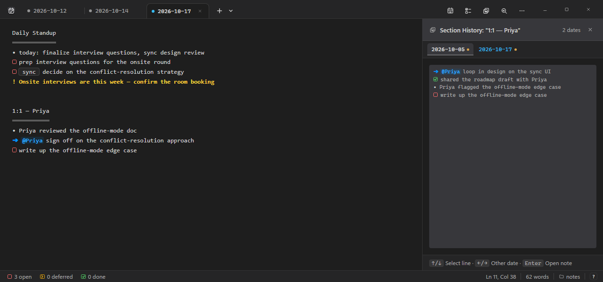

# ChronoNote

A keyboard-driven app for daily notes, meeting logs and action items. You type plain
text with a few short symbols; ChronoNote shows them as checkboxes, arrows and
sections, and helps you carry open work from day to day. Every note stays an ordinary
`.txt` file, one per day: no database, no hidden IDs.



## Highlights

- **Plain text you own.** Notes are `YYYY-MM-DD.txt` files in a folder you choose; any editor can open them.
- **Symbols that become glyphs.** `# ` is an open action, `v ` done, `> ` forwarded, `x ` won't do, `=> @name` delegated, `o ` an agenda topic. Click a glyph or press `Ctrl+1`–`4` to change it.
- **Open work moves forward.** Paste an open action into a later note and the original is marked as forwarded, with links in both directions.
- **Meetings remember themselves.** Reuse a section title and Section history (`Ctrl+Shift+H`) shows every earlier occurrence beside the note.
- **Your calendar fills in the day.** Optional sync with a `.agenda.json` file turns today's meetings into sections.
- **Peek for calls.** A small see-through window with only the current section, so you can take notes while you keep seeing the people you talk to.
- **Everywhere you are.** A Windows app with in-app updates, and a web app for any browser or phone that can sync with a OneDrive folder.

The [user guide](https://chrononote.mariendegelder.nl/guide.html) explains every symbol, shortcut and workflow.

## Get it

ChronoNote runs on Windows 10 and 11. On other systems, use the web app.

- **Windows:** download `ChronoNote_<version>_x64-setup.exe` from the
  [latest release](https://github.com/marien/ChronoNote/releases/latest). The app checks GitHub for new versions
  and installs them for you (About → Get early updates for beta versions).
- **Web app:** [app.chrononote.mariendegelder.nl](https://app.chrononote.mariendegelder.nl) saves to your browser
  and can sync with a OneDrive folder. Install it to your phone's home screen for an app-like experience.
- **Try it first:** the [demo](https://chrononote.mariendegelder.nl) runs in your browser and keeps nothing.

## Using it

- **Learn it:** the [user guide](https://chrononote.mariendegelder.nl/guide.html), or `Ctrl+/` in the app for the
  shortcuts and symbols.
- **Your notes:** plain UTF-8 files named `YYYY-MM-DD.txt` in the folder set in Settings → Notes & Sync (default
  `~/Documents/Notes`). Earlier versions and deleted notes are kept for 30 days (in hidden folders next to them on desktop).
- **Bringing notes in:** [`docs/migration-guide.md`](docs/migration-guide.md) describes the format to convert
  existing notes into.
- **Calendar sync:** [`docs/agenda-file-guide.md`](docs/agenda-file-guide.md) describes the `.agenda.json` file
  that whatever syncs your calendar needs to write.

## Development

ChronoNote is built with [Tauri v2](https://tauri.app) (Rust), Svelte 5 and TypeScript, and CodeMirror 6. The same
frontend builds the desktop app, the web app and the demo.

**Prerequisites:** Node.js 22 or 24 (CI uses 24), Rust via [rustup](https://rustup.rs), and on Windows the
"Desktop development with C++" workload. macOS and Linux builds are untested (see the
[Tauri prerequisites](https://tauri.app/start/prerequisites/)).

```bash
npm install
npm run tauri dev       # the desktop app, with hot reload
npm run dev             # the frontend only, in a browser (add ?mock to run against the in-memory backend)
npm run tauri build     # an installer, in the Cargo target folder under release/bundle/nsis
```

**Tests:**

```bash
npm run check                  # svelte-check: TypeScript and Svelte types
npm test                       # Vitest: logic, grammar, contracts
cd src-tauri && cargo test     # Rust: storage, agenda, spell check
npm run test:e2e               # Playwright: the full frontend against a mock backend
```

CI ([`.github/workflows/test.yml`](.github/workflows/test.yml)) runs these on every push and pull request, plus a
real-app test on Windows and the layout specs with Windows fonts. [`tests/e2e/README.md`](tests/e2e/README.md)
explains the Playwright harness.

### Where things are documented

| Document | What it is for |
|---|---|
| [User guide](https://chrononote.mariendegelder.nl/guide.html) ([source](website/guide.html)) | How to use ChronoNote: symbols, shortcuts, workflows |
| [`docs/spec.md`](docs/spec.md) | The precise product and technical reference: syntax, behaviour, storage, backends, testing |
| [`docs/CHANGELOG.md`](docs/CHANGELOG.md) | The decision log: every change as a numbered section (§) with why it was made |
| [Releases](https://github.com/marien/ChronoNote/releases) | Release notes per version |
| [`docs/design/`](docs/design/README.md) | Design proposals and reviews behind larger changes |
| [`docs/AGENT_GUIDELINES.md`](docs/AGENT_GUIDELINES.md) | Rules and invariants for anyone, human or AI agent, changing the code |
| [`website/README.md`](website/README.md) | How the website, demo and web app are built and deployed |

## Contributing and support

Bug reports and ideas are welcome as [issues](https://github.com/marien/ChronoNote/issues). ChronoNote is a personal
project maintained by one person; read [CONTRIBUTING.md](CONTRIBUTING.md) before opening a pull request.

## License

[MIT](LICENSE)
